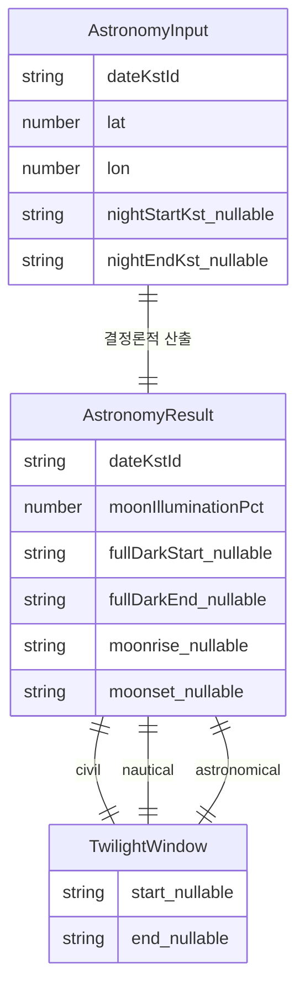

# Functional Spec — u1-astronomy

> 단위 U1 u1-astronomy (kind: library). 근거: entities.md, rules.md, stories(US3.1·US3.2·US4.2), contract-summary.md(C1·C5). 워크플로·상태 전이의 소스 오브 트루스이며, ER 다이어그램·규칙 요약은 파생 뷰(원본은 entities.md·rules.md).

## 이 단위가 구현하는 스토리/수용기준

story-map에서 U1은 US1.3, US2.1, US3.1, US3.2, US4.2에 걸쳐 조도·박명·완전한 밤·월출/월몰 계산을 담당한다. 이 단위가 직접 추적하는 수용기준:
- AC1.3.1(카드 요약용 달 조도) — 조도 계산 제공
- AC2.1.1·AC2.1.3(추천 판정 입력) — 조도 계산 제공
- AC3.1.1(상세 그래프용 달 밝기) — 조도 계산 제공
- AC3.1.2(박명 음영·완전한 밤) — 박명·완전한 밤 계산
- AC3.2.1(완전한 밤 구간·월출/월몰 숫자) — 완전한 밤·월출/월몰 계산
- AC3.2.3(월출/월몰 없음) — 범위 밖 null 반환
- AC4.2.1·AC4.2.2(계산 실패·재시도) — 오류 전달

(U1은 계산 라이브러리이므로 화면 수용기준의 "표시" 부분은 U4가, "값 산출" 부분을 U1이 맡는다. 공유 스토리의 표시 책임은 U4 traceability가 담당.)

## 핵심 워크플로 (소스 오브 트루스)

### WF1. computeAstronomy(input) → AstronomyResult | AstronomyComputationError

1. 입력 검증: dateKstId 형식(YYYY-MM-DD), lat∈[-90,90], lon∈[-180,180] 확인. 실패 시 → BR5.1에 따라 AstronomyComputationError(code="astronomy_failed", retryable=true) 반환하고 종료.
2. 내부 시간 기준 설정: dateKstId를 KST 날짜로 해석하고 계산은 UTC로 수행(BR4.2).
3. 달 조도 계산: 해당 날짜·좌표의 illuminated fraction을 계산(BR1.1). 월출/월몰 유무와 무관하게 항상 산출.
4. 박명 3종 계산: 시민·항해·천문 박명의 저녁(dusk)·새벽(dawn) 경계 시각을 계산(BR2.1). 성립하지 않는 경계는 null.
5. 완전한 밤 계산: 저녁 천문박명 종료와 새벽 천문박명 시작이 모두 성립하고 순서가 맞으면 fullDarkStart/End 설정, 아니면 둘 다 null(BR2.2, Q2).
6. 월출/월몰 계산: "그날 밤"(nightStart~nightEnd) 범위 안의 월출·월몰 시각을 각각 구함. 범위 안에 없으면 각각 null(BR3.1). nightStart/End가 입력에 없으면 BR3.2의 기본 범위(해당 KST 날짜 18:00 ~ 다음날 06:00)를 적용해 결정론적으로 판정한다(둘 중 하나만 오면 BR5.1 오류).
7. 표시 반올림: 조도(0~100%)·모든 시각(분 단위)을 표시 정밀도로 반올림(BR4.1), 시각은 KST ISO 문자열로 변환(BR4.2).
8. AstronomyResult 조립·반환.

### WF2. 호출부의 재시도 (AC4.2.1·AC4.2.2)

1. 호출부(U4)가 computeAstronomy 호출.
2. AstronomyComputationError(retryable=true) 반환 시 → U4가 에러 메시지+재시도 수단 표시.
3. 재시도 시 동일 입력으로 재호출 → 결정론적이므로 입력이 유효해지면 정상 결과.

(U1 자체는 자동 재시도를 하지 않는다 — 결정론적 계산이라 같은 입력은 같은 결과. 재시도 UI는 U4.)

## 상태 전이

U1은 상태를 보존하지 않는 순수 함수 라이브러리다(결정론적 입출력). 지속되는 생명주기 엔티티나 상태 기계가 없다. 유일한 "전이"는 한 호출 내 성공↔실패 분기(WF1 step 1의 검증 결과)이며, 이는 WF1에 담겨 있다.

## 파생 뷰 — ER 다이어그램 (원본: entities.md)

<!-- Text fallback: AstronomyInput 하나가 AstronomyResult 하나를 결정론적으로 산출한다. AstronomyResult는 civil/nautical/astronomical TwilightWindow를 각각 하나씩 포함한다. 조도·완전한밤·월출/월몰은 AstronomyResult의 필드이며 완전한밤·월출/월몰은 nullable. -->

## 파생 뷰 — 규칙 요약 (원본: rules.md)

| ID | 요지 |
|----|------|
| BR1.1 | 달 조도는 항상 실제값(0~100%) |
| BR2.1 | 박명 3종 경계, 미성립 null |
| BR2.2 | 완전한 밤 = 천문박명 사이, 미성립 null 쌍 |
| BR3.1 | 월출·월몰은 "그날 밤" 범위 안일 때만 |
| BR3.2 | "그날 밤" 입력 없으면 기본 범위 적용 |
| BR4.1 | 경계에서만 반올림 |
| BR4.2 | 시각은 KST ISO(내부 UTC) |
| BR5.1 | 유효하지 않은 입력은 오류 전달 |

## Assumptions & Open Questions

- "그날 밤" 경계 입력이 없을 때의 기본 범위는 BR3.2로 결정론적으로 정의됨(18:00~익일 06:00). U3이 범위를 산출하면 그 값을 쓴다. [assumption]
- C1 계약 갱신 2건(AstronomyInput 경계 입력 추가, TwilightWindow nullable)은 entities.md "C1 계약 갱신"에 기록됨; U3·U4와 code-generation이 호출부를 함께 맞춘다. [assumption]
