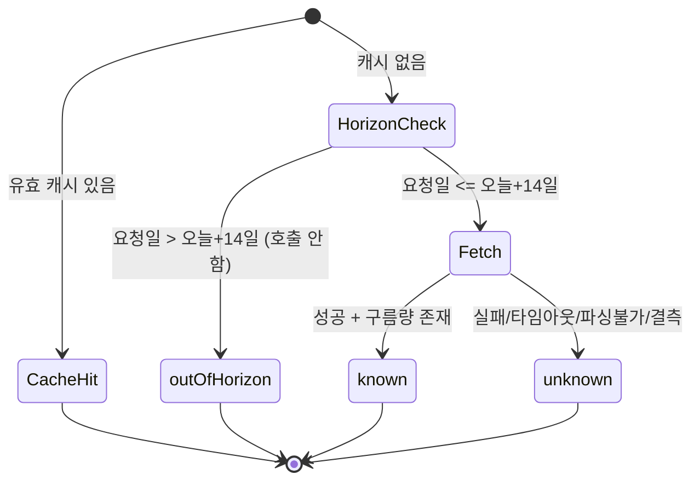
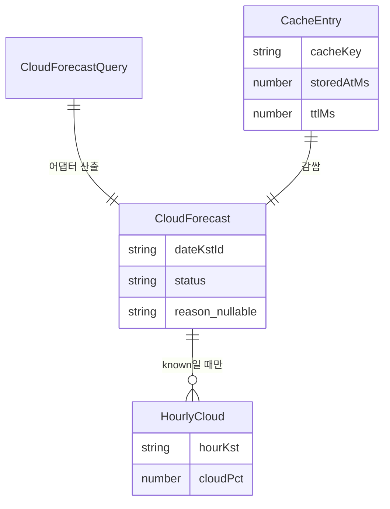

# Functional Spec — u2-weather-data

> 단위 U2 u2-weather-data (kind: library). 근거: entities.md, rules.md, contract-summary.md(C2·C4), stories(US1.3·US3.1·US4.1). 워크플로·상태의 소스 오브 트루스이며, ER 다이어그램·규칙 요약은 파생 뷰.

## 이 단위가 구현하는 스토리/수용기준

story-map에서 U2는 US1.3, US3.1, US4.1에 걸쳐 구름량 데이터 제공·캐시·실패 처리를 담당한다. 직접 추적하는 수용기준:
- AC1.3.2(카드 구름 요약) — known 구름량 제공
- AC1.3.3(먼 날짜 "곧 표시") — outOfHorizon 상태 제공
- AC3.1.3(상세 구름 곡선 없음 안내) — outOfHorizon 상태 제공
- AC4.1.1(날씨 실패 시 부분 표시) — unknown 상태 제공
- AC4.1.2(짧은 캐시로 재호출 억제) — TTL 캐시

(U2는 데이터 라이브러리이므로 "표시"는 U4가, "데이터 상태 산출"을 U2가 맡는다.)

## 핵심 워크플로 (소스 오브 트루스)

### WF1. getCloudForecast(query) → Promise<CloudForecast>

1. 캐시 조회: cacheKey(dateKstId+lat+lon)로 DataCache를 본다. 유효한(TTL 미만) 항목이 있으면 그 CloudForecast를 반환하고 종료(BR3.1).
2. 예보 지평 사전 컷오프: 요청 dateKstId가 오늘(KST)+14일(FORECAST_HORIZON_DAYS)을 넘으면 → API 호출 없이 status=outOfHorizon 반환, 캐시에 긴 TTL로 저장(BR1.1). 종료.
3. 외부 호출(14일 이내): WeatherClient가 외부 날씨 API를 타임아웃과 함께 호출한다(BR1.2, BR4.1).
4. 응답 정규화(BR2.2):
   - 성공 + 해당 날짜 구름량 존재 → status=known, hourlyCloudPct 채움.
   - 호출 실패/타임아웃/파싱불가/구름량 결측 → status=unknown, reason에 내부 사유(BR2.1).
5. 캐시 저장: 결과를 TTL과 함께 저장. known/outOfHorizon은 긴 TTL, unknown은 짧은 TTL(BR3.1). 반환.

### WF2. 호출부의 재조회(재시도) — AC4.1.1

1. 호출부(U3·U4)가 unknown을 받으면 "구름량 알 수 없음"으로 표시(표시는 U4).
2. u2는 자동 재시도하지 않는다(BR3.2). 사용자가 화면을 재진입하면 unknown의 짧은 TTL이 만료돼 WF1이 다시 호출한다.

## 상태 전이

u2는 영속 상태가 없는 데이터 접근 라이브러리이며, 유일한 상태는 각 CloudForecast의 status 분기다:

<!-- Text fallback: 유효 캐시가 있으면 그대로 반환. 없으면 지평 체크: 14일 초과면 호출 없이 outOfHorizon, 14일 이내면 호출해 성공+구름량이면 known, 실패/결측이면 unknown. 모든 결과는 TTL로 캐시. -->

## 파생 뷰 — ER 다이어그램 (원본: entities.md)

<!-- Text fallback: CloudForecastQuery 하나가 CloudForecast 하나를 산출. CloudForecast는 known일 때만 여러 HourlyCloud를 포함. CacheEntry가 CloudForecast를 감싸 TTL과 함께 보관. -->

## 파생 뷰 — 규칙 요약 (원본: rules.md)

| ID | 요지 |
|----|------|
| BR1.1 | 14일 초과 → 호출 없이 outOfHorizon |
| BR1.3 | 불변식: FORECAST_HORIZON_DAYS ≤ 실제 API 예보 범위 |
| BR1.2 | 14일 이내 → 호출해 known |
| BR2.1 | 14일 이내 실패/결측 → unknown(컷오프 이내는 outOfHorizon 아님) |
| BR2.2 | 어댑터가 3-상태 정규화 |
| BR3.1 | TTL 캐시 |
| BR3.2 | 자동 재시도 없음 |
| BR4.1 | 타임아웃·키 불필요 공개 API |

## Assumptions & Open Questions

- 구체 날씨 API(Open-Meteo 1순위)의 실제 예보 범위가 14일과 다르면 FORECAST_HORIZON_DAYS 상수를 그 범위 이하로 code-generation에서 맞춘다(BR1.3 불변식: 컷오프 ≤ 실제 범위). 이 불변식이 outOfHorizon(컷오프 초과)과 unknown(컷오프 이내 실패/결측)을 겹치지 않게 보장한다. [assumption]
