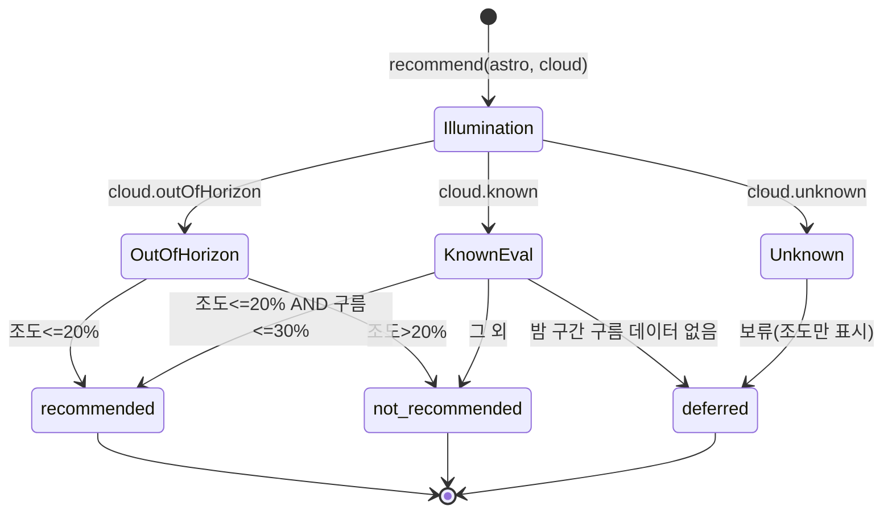
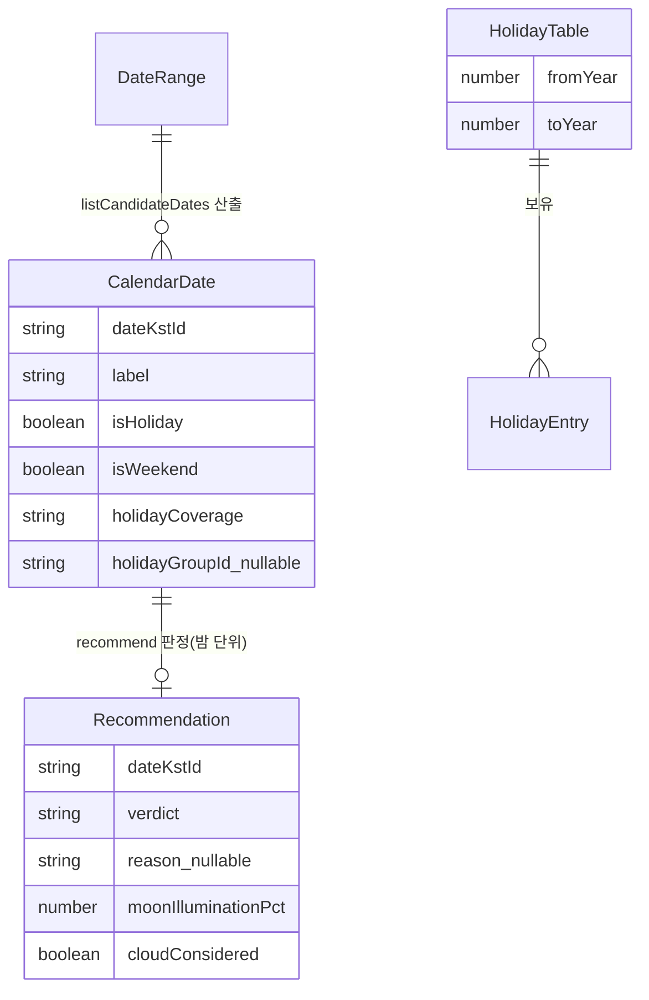

# Functional Spec — u3-domain-rules

> 단위 U3 u3-domain-rules (kind: library). 근거: entities.md, rules.md, contract-summary.md(C1·C2·C3), stories(US1.1~US1.3·US2.x). 워크플로·상태의 소스 오브 트루스이며, ER 다이어그램·규칙 요약은 파생 뷰.

## 이 단위가 구현하는 스토리/수용기준

story-map에서 U3는 달력 산출과 추천 판정을 담당한다. 직접 추적하는 수용기준:
- AC1.1.1 / AC1.1.2(3개월+ 주말·공휴일 목록, "그날 밤" KST 범위) — listCandidateDates
- AC1.2.1(공휴일 연휴 없으면 주말 표시) — BR1.2
- AC2.1.1(known: 조도 ≤ 20% AND 구름 ≤ 30% → 추천) — BR2.1
- AC2.1.2(known: 조도 ≤ 20%이나 구름 > 30% → 추천 아님) — BR2.2
- AC2.1.3(outOfHorizon: 구름 예보 없는 먼 날짜, 조도만으로 추천) — BR2.3
- (표시·강조는 U4가, "날짜 산출·추천 판정"을 U3가 맡는다. AC2.1.4(색 비의존 강조)는 U4.)

## 핵심 워크플로 (소스 오브 트루스)

### WF1. listCandidateDates(range: DateRange) → CalendarDate[]

1. 범위 전개: fromKstId부터 months(≥3)개월까지의 날짜를 순회한다(BR1.1).
2. 각 날짜 분류:
   - 연도가 HolidayTable 커버 범위 안이면 holidayCoverage=covered, 내장 테이블로 isHoliday 판정(대체공휴일 포함). 범위 밖이면 holidayCoverage=outOfTable, isHoliday=false(BR1.5).
   - isWeekend는 요일로 판정(토·일).
3. 후보 선별: isWeekend OR isHoliday인 날짜만 후보 밤으로 채택. 공휴일 연휴가 전무하면 주말만으로 구성(BR1.2).
4. 밤 범위 부여: 각 후보에 nightStartKst(저녁)·nightEndKst(다음날 새벽)를 KST로 설정(BR1.3).
5. 연휴 묶음: 연속된 후보(주말·공휴일이 끊김 없이 이어짐)에 동일 holidayGroupId와 묶음 라벨(공휴일명 우선, 없으면 '주말')을 부여(BR1.4).
6. 날짜순 CalendarDate[] 반환.

### WF2. recommend(astro: AstronomyResult, cloud: CloudForecast) → Recommendation

1. 달 조도 취득: astro.moonIlluminationPct(0~100).
2. 구름 상태 분기(C2·BR2.3·BR2.4):
   - cloud.status=outOfHorizon → cloudConsidered=false. 조도만 판정: 조도 ≤ 20%면 recommended, 아니면 not_recommended(BR2.3).
   - cloud.status=unknown → verdict=deferred, reason='cloud unknown', cloudConsidered=false. 조도는 표시용 전달, 추천 점수 산출 안 함(BR2.4).
   - cloud.status=known → 밤 구간(nightStart~nightEnd)의 시간별 구름량을 집계(BR2.6). 밤 구간 데이터가 전무하면 deferred(BR2.4). 있으면 3번으로.
3. known 판정: 조도 ≤ 20% AND 밤 구름량 ≤ 30% → recommended, 아니면 not_recommended(BR2.1·BR2.2·BR2.5).
4. Recommendation 반환(dateKstId, verdict, reason, moonIlluminationPct, cloudConsidered).

### WF3. 정렬(호출부 U4 지원) — Q4

recommend 결과 묶음을 정렬할 때 recommended → not_recommended → deferred 순으로 두되, deferred를 목록에서 제외하지 않는다(BR2.4). U3는 정렬 키(verdict 우선순위)를 제공하고 실제 렌더링·정렬은 U4가 수행할 수 있다.

## 상태 전이

U3는 영속 상태가 없는 순수 규칙 라이브러리이며, 유일한 상태는 각 Recommendation의 verdict 분기다:

<!-- Text fallback: 달 조도를 먼저 본 뒤 구름 상태로 분기. outOfHorizon이면 조도만으로 recommended/not_recommended. unknown이면 deferred. known이면 밤 구간 구름을 집계해 데이터가 없으면 deferred, 있으면 조도≤20%·구름≤30%면 recommended, 아니면 not_recommended. -->

## 파생 뷰 — ER 다이어그램 (원본: entities.md)

<!-- Text fallback: DateRange 하나가 여러 CalendarDate를 산출. 각 CalendarDate가 recommend로 하나의 Recommendation을 얻음. HolidayTable이 여러 HolidayEntry를 보유하고, CalendarDate.holidayCoverage는 날짜 연도와 테이블 범위 비교로 결정. -->

## 파생 뷰 — 규칙 요약 (원본: rules.md)

| ID | 요지 |
|----|------|
| BR1.1 | 3개월+ 주말·공휴일 연휴 날짜순 산출 |
| BR1.2 | 공휴일 없으면 주말만 포함 |
| BR1.3 | '그날 밤' = KST 저녁~새벽 |
| BR1.4 | 연속 주말+공휴일 → '연휴' 묶음, 라벨=묶음 이름 |
| BR1.5 | 공휴일=내장 테이블(커버 연도 범위), 범위 밖=주말만 |
| BR2.1 | 조도 ≤ 20% AND (known이면 구름 ≤ 30%) → recommended |
| BR2.2 | 미충족 → not_recommended |
| BR2.3 | outOfHorizon → 조도만으로 추천 |
| BR2.4 | 범위 안 unknown → deferred(보류, 뒤로) |
| BR2.5 | 임계값 조도 ≤ 20%·구름 ≤ 30% 단일 상수 |
| BR2.6 | 밤 구간 구름 집계, 데이터 없으면 deferred |

## Assumptions & Open Questions

- 내장 공휴일 테이블 커버 연도 범위, 대체공휴일 규칙, 밤 구간 구름량 집계 방식은 code-generation에서 확정한다. [assumption]
