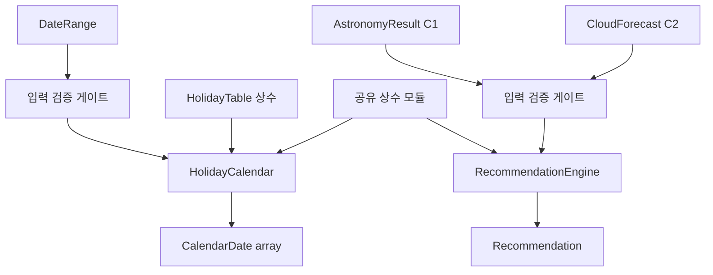

# Logical Components — u3-domain-rules

> 단위 U3 u3-domain-rules (kind: library). 근거: components.md(HolidayCalendar·RecommendationEngine), functional-spec(WF1·WF2), security-design(SD1~SD3), contract-summary(C3). 설계 수준의 내부 컴포넌트 분해; 구현 파일은 code-generation.

## 논리 컴포넌트

```yaml
components:
  - name: HolidayCalendar
    responsibility: "주말·공휴일 연휴 날짜 산출(listCandidateDates). 내장 공휴일 테이블로 공휴일 판정, 커버 범위 밖은 주말만. 연휴 묶음(holidayGroupId)·밤 범위(nightStart/End) 부여."
    inputs: [DateRange]
    outputs: [CalendarDate array]
    depends_on: [HolidayTable 상수, 공유 상수 모듈]
    rules: [BR1.1, BR1.2, BR1.3, BR1.4, BR1.5]

  - name: RecommendationEngine
    responsibility: "밤 단위 추천 판정(recommend). AstronomyResult·CloudForecast를 받아 3-상태(recommended/not_recommended/deferred) 산출. 밤 구간 구름 집계·임계값 비교."
    inputs: [AstronomyResult, CloudForecast]
    outputs: [Recommendation]
    depends_on: [공유 상수 모듈]
    rules: [BR2.1, BR2.2, BR2.3, BR2.4, BR2.5, BR2.6]

  - name: 공유 상수 모듈 (constants)
    responsibility: "정책성 수치 단일 지점: 추천 임계값(20/30), 공휴일 테이블 커버 범위, 밤 집계 방식. 계산 로직과 분리(SD3, ADR-002)."
    inputs: []
    outputs: [상수]
    depends_on: []
    rules: [BR2.5, BR1.5]

  - name: 입력 검증 게이트 (validation)
    responsibility: "진입점 입력 검증(SD1). DateRange·AstronomyResult·CloudForecast 형식·범위를 예외 없이 검증."
    inputs: [DateRange | AstronomyResult | CloudForecast]
    outputs: [유효성 결과]
    depends_on: []
    rules: [NFR6.2]
```

## 컴포넌트 다이어그램



<!-- Text fallback: DateRange가 검증 게이트를 거쳐 HolidayCalendar로 들어가 HolidayTable 상수·공유 상수와 함께 CalendarDate 목록을 낸다. AstronomyResult·CloudForecast가 검증 게이트를 거쳐 RecommendationEngine으로 들어가 공유 상수와 함께 Recommendation을 낸다. -->

## 사람이 읽는 요약

U3는 두 핵심 컴포넌트(HolidayCalendar·RecommendationEngine)와 두 횡단 모듈(공유 상수·입력 검증 게이트)로 나뉜다. 달력 산출과 추천 판정은 서로 독립적이며 공유 상수 모듈을 통해서만 정책 수치를 공유한다. 모든 공개 함수는 순수하며 외부 의존이 없다. C3 계약(listCandidateDates·recommend)이 외부에 노출되는 유일한 표면이다.

## Sources

- components.md(HolidayCalendar·RecommendationEngine), functional-spec.md(WF1·WF2), security-design.md(SD1~SD3), rules.md(BR 전반), contract-summary.md(C3).

## Assumptions & Open Questions

- 컴포넌트의 구체 파일 분해(단일 모듈 vs 다중 파일)는 code-generation에서 확정한다. [assumption]
