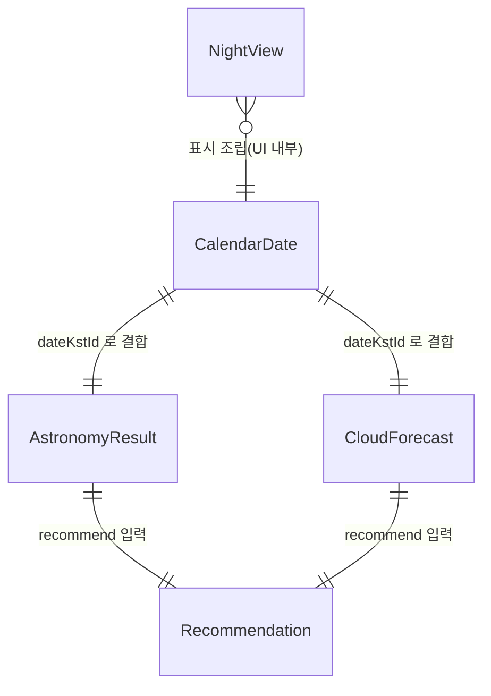

# Functional Spec — u4-web-ui

> 단위 U4 u4-web-ui (kind: ui): 다크모드 모바일 우선 웹 화면 2종. 소유 엔티티 없음(표시 전용).
> U1(C1 computeAstronomy)·U2(C2 getCloudForecast)·U3(C3 listCandidateDates/recommend)의 공개 모듈
> 계약을 동기/비동기로 호출해 데이터를 모아 렌더링한다. 이 파일은 UI-only 단위의 **워크플로·화면
> 상태전이의 단일 진실원**이며, entities.md/rules.md 의존이 없다.
> 근거: unit-of-work.md(U4), requirements.md(FR1~FR6, NFR1·NFR2·NFR7), stories.md(US1.1~US4.2),
> contract-summary.md(C1·C2·C3), 메모리 학습(다크모드·강조·월출몰·네비·상태구분).

## 1. 범위와 경계

- **두 화면**: 메인 목록(HolidayListView)과 상세 그래프(NightDetailView).
- **데이터 출처**: U3 `listCandidateDates`(후보 날짜) → 각 날짜마다 U1 `computeAstronomy`(동기)·U2 `getCloudForecast`(Promise) → U3 `recommend`(동기)로 추천 판정. UI는 이 결과를 조립·표시만 한다.
- **좌표**: 전국 대표 좌표 1개 상수 `DEFAULT_LOCATION = { lat: 37.5665, lon: 126.9780 }`(서울). U1/U2 호출 입력에 전달.
- **UI는 임계값/판정 로직을 갖지 않는다**: 추천 여부는 U3 `Recommendation.verdict`만 읽는다(FR2.4는 U3 소유).
- **온라인 전제**(NFR4): 오프라인 전용 저장 없음. U2가 짧은 캐시 보유.

## 2. 데이터 조립 모델 (화면 공통)

한 날짜(`dateKstId`)의 표시 단위를 UI 내부에서 `NightView`로 조립한다(표시 전용 뷰모델, 영속 아님):

```text
NightView(dateKstId):
  calendar  = CalendarDate              # U3 listCandidateDates 결과의 한 항목
  astro     = AstronomyResult | error   # U1 computeAstronomy (동기, 드물게 throw)
  cloud     = CloudForecast             # U2 getCloudForecast (status: known|outOfHorizon|unknown)
  verdict   = Recommendation            # U3 recommend(astro, cloud)
  state     = loading | ok | partial | error   # 아래 §5 상태 규칙
```

- `astro`가 `AstronomyComputationError`(C1 throws)면 그 NightView.state=error(천문은 핵심, FR6.2).
- `cloud.status=unknown`이면 구름 부분만 "구름량 알 수 없음", 나머지 표시 → state=partial(FR6.1 갱신).
- `cloud.status=outOfHorizon`이면 "날씨는 날짜가 가까워지면 표시" 중립 안내, state=ok(에러 아님).

### 2.1 상위 함수의 실제 호출 형태 (계약 정합)

UI가 호출할 때의 실제 시그니처·입력을 못박는다(src/astronomy/types.ts, src/weather/types.ts·weather.ts, src/domain-rules/types.ts 대조).

- **U1**: `computeAstronomy(input: AstronomyInput): AstronomyResult` (동기, 드물게 throw).
  `AstronomyInput = { dateKstId, lat, lon, nightStartKst?, nightEndKst? }`.
  UI는 **반드시** 해당 날짜 `CalendarDate.nightStartKst`/`nightEndKst`를 `AstronomyInput.nightStartKst`/`nightEndKst`에 넘긴다. 넘기지 않으면 U1이 기본 범위(18:00~익일 06:00, BR3.2)를 써서 x축(달력 밤 범위)과 음영·월출몰(천문 밤 범위)이 어긋날 수 있다. 좌표는 `DEFAULT_LOCATION`.
- **U2**: `getCloudForecast(query: CloudForecastQuery, options)` (Promise).
  `CloudForecastQuery = { dateKstId, lat, lon }`(좌표는 `DEFAULT_LOCATION`).
  `options`로 **공유 캐시**(`cache`)와 기준 시각(`nowMs`)을 주입한다 — §5.1 캐시 참조. 예외를 던지지 않고 `status`로 성공/먼 날짜/실패를 구분한다.
- **U3**: `listCandidateDates(range): CalendarDate[]`(동기), `recommend(astro, cloud): Recommendation`(동기), 정렬은 `verdictSortKey`. UI는 `Recommendation.verdict`만 읽는다.

**달 밝기의 시간축 표현 (갱신 2026-10-27 — 수평 기준선 결정 번복):** 종전 설계는 `moonIlluminationPct`가 하룻밤 단일 스칼라라는 이유로 좌y축 달 밝기를 **수평 기준선**으로 그렸다. 그러나 관측자가 체감하는 달 밝기는 밤새 크게 변한다 — 위상(illuminated fraction)은 하룻밤에 거의 안 변하지만, **지면에 닿는 달빛은 달 고도에 따른 대기 소광(airmass)과 입사각으로 월출 직후·월몰 직전에는 남중 대비 수 % 수준까지 떨어진다**. 이 앱의 핵심 가치("좋은 관측 밤 고르기")에는 바로 이 시간별 체감 밝기가 중요하므로, 좌y축을 **시간별 꺾은선**(월출 ~0 → 남중 피크 → 월몰 ~0)으로 그린다.
  - **C1 계약 확장(이번 변경)**: `AstronomyResult`에 시간별 배열 `moonHourly: { hourKst: string; altitudeDeg: number; relativeBrightnessPct: number }[]`를 추가한다. U1이 그날 밤 범위를 균등 샘플링(예: 30분 간격)해 각 시각의 달 고도를 계산하고, **상대 체감 밝기(남중=100% 기준)** = 대기투과율(airmass 기반 소광) × 입사각(sin 고도) × 위상 스케일(illuminated fraction)로 산출한다. 소광계수는 상수로 분리(맑은 날 가정, 주석에 근거). 달이 지평 아래(고도 ≤ 0)인 시각은 0.
    - **transit(100%) 기준 정의(결정성)**: 기준은 그 밤 달의 **실제 천체 남중 고도**(샘플 범위 밖이어도 그날 밤의 이론 남중 고도)로 고정한다. 범위 내 남중 유무와 무관하게 상대 밝기가 결정적이 되도록 하며, U1 주석에 근거를 남긴다(월출만/월몰만 있는 밤도 스케일이 흔들리지 않음).
    - **좌y축 의미 명시**: 곡선의 좌y축은 "남중 대비 상대 체감 밝기(%)"이며, 요약의 `moonIlluminationPct`(위상 조도 %)와는 다른 의미의 백분율이다. 축·범례 텍스트로 구분해 혼동을 막는다.
  - 기존 `moonIlluminationPct`(단일 위상값)는 **유지**한다: 카드 요약·추천 입력용 위상 지표로 계속 쓰이며, 상세 요약에도 "달 밝기(위상)"로 표기. 곡선은 `moonHourly`로 그린다.
  - 구름량(`hourlyCloudPct`)은 종전대로 `status=known`일 때만 우y축 시계열로 그린다.

## 3. 화면 WF1 — 메인 목록 (HolidayListView)

```text
WF1 메인 목록 렌더링:
 1. 화면 진입 → 전체 로딩 상태 표시(스켈레톤 카드)                        [AC1.1.3]
 2. range = { fromKstId: 오늘(KST), months: 3 }
 3. dates = U3.listCandidateDates(range)                                  [AC1.1.1, AC1.1.2]
 4. dates가 비면 "표시할 날짜가 없어요" 안내                               [AC1.2.2]
    - (연휴 없으면 U3가 이미 주말을 포함하므로 보통 비지 않음)             [AC1.2.1]
 5. 각 date에 대해 NightView 조립(§2, §2.1):
    - astro = computeAstronomy({ dateKstId, lat, lon, nightStartKst, nightEndKst })  # 밤 범위 전달
    - cloud = await getCloudForecast({ dateKstId, lat, lon }, { nowMs, cache })      # 공유 캐시 주입
    - verdict = recommend(astro, cloud)
    - U2 호출은 병렬(Promise.all)로 모아 체감 로딩 단축(NFR3 지향)
 6. 카드 렌더링(날짜/연휴명, 달 위상 아이콘+조도%, 구름 요약 또는 안내)     [AC1.3.1~1.3.3]
 7. verdict.verdict=recommended인 카드: 노란 테두리 + 별 아이콘 + "추천" 라벨 [AC2.1.1~2.1.4]
    - not_recommended/deferred는 강조 없음(deferred는 목록에서 제외하지 않음)[AC2.1.2]
 8. 카드 탭 → WF2 상세로 이동(dateKstId 전달)                              [AC3.1.1 진입]
```

추천 강조는 **색 비의존**: 노란 테두리(색) + 별 아이콘(형태) + "추천" 텍스트 라벨을 항상 함께 표기한다(NFR1, AC2.1.4). deferred(예보 unknown)는 조용히 판정 보류 — 강조도 "비추천"도 아니며 목록 뒤쪽에 둔다(U3 `verdictSortKey`).

## 4. 화면 WF2 — 상세 그래프 (NightDetailView)

```text
WF2 상세 그래프 렌더링(입력: dateKstId):
 1. 로딩 상태 표시
 2. 해당 날짜 CalendarDate 확보(목록 조립분 재사용 또는 재조회).
    NightView 조립(§2, §2.1): 
      astro = computeAstronomy({ dateKstId, lat, lon, nightStartKst, nightEndKst })  # 밤 범위 전달 필수
      cloud = await getCloudForecast({ dateKstId, lat, lon }, { nowMs, cache })       # 공유 캐시 주입
 3. astro 실패 시 → 에러 메시지 + "다시 시도" 버튼(WF3)                    [AC4.2.1]
 4. 이중축 그래프 렌더(Chart.js):                                         [AC3.1.1]
    - x축: 그날 밤 KST 시간(calendar.nightStartKst ~ nightEndKst) — astro 입력과 동일 범위.
      내부 계산은 epoch ms(linear 스케일)이되, 축 눈금은 **KST HH:MM로 포맷**해 표시한다
      (ticks.callback로 ms→"19:00"·"23:00" 변환; 계산용 epoch와 표시용 시각 분리). epoch 원본값 노출 금지.
    - 좌y축(0~100): 달 체감 밝기 = astro.moonHourly[].relativeBrightnessPct **시간별 꺾은선**
      (월출 ~0 → 남중 피크 → 월몰 ~0, §2.1 갱신). 수평 기준선 아님. 위상값 moonIlluminationPct는 요약에 별도 표기.
    - 우y축(0~100): 구름량 곡선(cloud.hourlyCloudPct) — status=known일 때만(실제 시계열)
 5. 배경 음영(annotation box) — 어두워지는 순서대로 **농도 차등**:          [AC3.1.2]
    - 시민박명보다 바깥(황혼 전)은 음영 없음(가장 밝음) → 시민박명 옅은 음영 → 항해박명 중간 음영 →
      천문박명 진한 음영 → 완전한 밤 가장 진한 음영. 겹치는 구간은 안쪽(더 어두운) 음영이 이기도록 레이어링.
    - 각 음영 box 안에 **라벨 텍스트**("시민"/"항해"/"천문"/"완전한 밤")를 넣어 가시성을 확보한다
      (종전 display:false로 라벨이 안 보이던 문제 보완; 대비·겹침 고려해 box 내부 배치).
    - null 처리: 각 박명의 start 또는 end가 null이면(해당 경계 미성립, 예: 서울 하지 무렵
      천문박명) 그 음영 box를 그리지 않는다. fullDarkStart 또는 fullDarkEnd가 null이면
      완전한 밤 음영 box도 그리지 않는다(요약에서는 "없음" 표기).
 6. cloud.status != known이면 구름 곡선 생략 + "날씨는 날짜가 가까워지면" 안내 [AC3.1.3]
 7. 핵심 숫자 요약: 달 위상(moonIlluminationPct), 완전한 밤 시작·끝, 월출·월몰(null이면 "없음";
    라벨과 값 중복 금지 — 값은 "없음"만, 라벨이 "월출"/"월몰"/"완전한 밤"을 제공)            [AC3.2.1, AC3.2.3]
 8. 범례: 달 체감 밝기 곡선/구름량선/박명 음영(농도 구분)/완전한 밤 의미 설명  [AC3.2.2]
 9. 뒤로가기 → 메인 목록 이전 위치 복귀. 이전/다음 연휴 바로가기 버튼 없음.   [AC3.3.1, AC3.3.2]
```

## 5. 화면 상태 머신 (각 화면 공통: loading → ok|partial|error)

```text
상태 전이(화면 단위 및 카드 단위):
  [시작] --진입--> loading
  loading --천문 OK & 날씨 known--> ok                                    [AC4.1.3]
  loading --천문 OK & 날씨 unknown(실패)--> partial                       [AC4.1.1, FR6.1]
  loading --천문 OK & 날씨 outOfHorizon--> ok(+먼 날짜 안내)              [AC1.3.3, AC3.1.3]
  loading --천문 실패--> error                                           [AC4.2.1]
  error --"다시 시도" 탭--> loading  (WF3)                                [AC4.2.2]
  partial: 달·박명·월출몰 표시 + 구름만 "구름량 알 수 없음"               [AC4.1.1]
```

- **partial vs error 경계**: 날씨 실패는 partial(핵심 아님), 천문 실패는 error(핵심). 이는 U2가 예외를 안 던지고 status로 반환(C2), U1은 드물게 throw(C1)하는 계약과 일치.

### 5.1 캐시 소유·주입 (AC4.1.2, NFR4)

저장·TTL 정책은 U2(`DataCache`)가 소유하지만, **캐시 인스턴스의 수명과 공유는 UI(U4)의 책임**이다. `getCloudForecast`는 `options.cache`가 주입되지 않으면 호출마다 새 캐시를 만들어 세션 내 재사용이 일어나지 않기 때문이다. 따라서:

- UI는 App 루트(모듈 스코프)에서 `DataCache` 인스턴스를 **단 하나** 생성해 보유한다.
- WF1의 날짜별 호출, WF2 상세 진입, WF3 재시도까지 **모든** `getCloudForecast` 호출에 그 동일 인스턴스를 `options.cache`로 주입한다 → 같은 날짜 재방문 시 캐시 히트로 무료 한도를 보호한다(AC4.1.2).
- 기준 시각은 `options.nowMs`로 함께 주입해 outOfHorizon 컷오프·TTL 판정을 결정적으로 만든다(테스트·일관성).

### 6. 워크플로 WF3 — 재시도

```text
WF3 재시도(천문 실패):
 1. error 상태에서 "다시 시도" 노출                                      [AC4.2.1]
 2. 탭 → 해당 dateKstId에 대해 NightView 재조립(§2·§2.1) 재실행
       (computeAstronomy에 nightStartKst/nightEndKst, getCloudForecast에 공유 cache·nowMs 동일 주입)
 3. 성공 → ok/partial 로 전이, 실패 → error 유지                         [AC4.2.2]
```

## 7. 접근성·반응형 (NFR1, NFR2)

- 다크모드 기본 테마. 추천 강조는 색만으로 전달 금지(아이콘+라벨 병행).
- 모바일 세로 우선 레이아웃, 데스크톱에서 비파괴(가로 확장 허용).
- 그래프 색/대비는 다크 배경에서 판독 가능하도록 지정. 범례로 선·음영 의미 보강.

## 8. 엔티티 관계 (derived view)

U4는 소유 엔티티가 없다. 아래는 소비하는 상위 계약 타입의 관계를 **읽기 전용**으로 도식화한 파생 뷰이며, 진실원은 각 상위 단위의 계약(C1·C2·C3)이다.



## 9. 규칙 요약 (derived view)

U4는 비즈니스 규칙(BR)을 소유하지 않는다(추천 판정은 U3, 계산은 U1). UI 동작은 표시 정책이며 상태 머신(§5)과 워크플로(§3·§4·§6)로 규정된다. traceability.json은 상위 AC를 U4의 표시 책임으로 추적한다.

## Assumptions & Open Questions

None.
