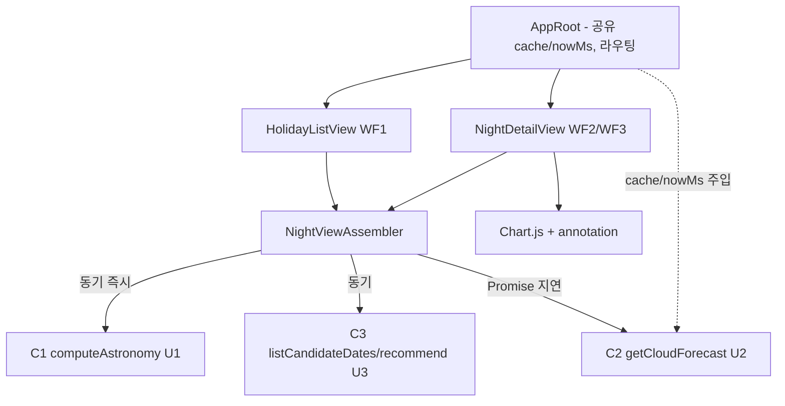

# Logical Components — u4-web-ui

> 단위 U4 u4-web-ui (kind: ui). 근거: functional-spec(§1~§6), performance-design(PD1~PD4), security-design(SD1~SD4), contract-summary(C1·C2·C3), nfr-design-questions.md(Q1). 설계 수준의 내부 컴포넌트 분해; 구현 파일은 code-generation.
> u4는 소유 엔티티가 없는 표시 전용 단위다. 아래는 책임 경계(논리 컴포넌트)이며, 구현 파일 1:1 매핑이 아니다.

## 논리 컴포넌트

```yaml
components:
  - name: AppRoot
    responsibility: "공유 DataCache 단일 인스턴스와 기준 시각(nowMs) 보유. 화면 라우팅(목록 <-> 상세, dateKstId 전달)과 뒤로가기 네비게이션. 모든 getCloudForecast 호출에 cache/nowMs 주입(PD3). 비밀값 보유하지 않음(SD1)."
    inputs: [DEFAULT_LOCATION 상수]
    outputs: [라우팅 상태, 공유 cache/nowMs]
    depends_on: [DataCache(U2 소유 타입)]
    covers: [NFR3.4, NFR6.1]

  - name: NightViewAssembler
    responsibility: "한 날짜의 NightView 조립(functional-spec §2). U1 computeAstronomy(동기)를 즉시 수행해 카드/상세 골격을 먼저 산출하고, U2 getCloudForecast(Promise) 도착 후 U3 recommend(astro, cloud)로 추천 판정을 채우는 점진 2단계(PD1). 상태 산출 loading/ok/partial/error(§5). 내부 사유(reason·error code) 차단·중립 문구 매핑(SD3)."
    inputs: [CalendarDate, DEFAULT_LOCATION, cache, nowMs]
    outputs: [NightView(astro, cloud, verdict, state)]
    depends_on: [C1 computeAstronomy, C2 getCloudForecast, C3 recommend]
    covers: [NFR3.1, NFR3.2, NFR3.3, NFR6.3]

  - name: HolidayListView
    responsibility: "WF1 메인 목록 렌더. U3 listCandidateDates로 후보 날짜 확보, 날짜별 NightView를 Promise.all 병렬 조립(PD2). 카드 렌더(날짜/연휴명·달 조도%·구름 요약). 추천 카드 색 비의존 강조(노란 테두리+별 아이콘+'추천' 라벨). 빈 목록 안내·스켈레톤."
    inputs: [DateRange, assembler]
    outputs: [카드 목록 UI]
    depends_on: [C3 listCandidateDates, NightViewAssembler]
    covers: [NFR1, NFR2, NFR3.1, NFR3.2]

  - name: NightDetailView
    responsibility: "WF2 상세 그래프 렌더. 단일 Chart.js 인스턴스(data 갱신, PD4) 이중축(달 밝기 수평 기준선/구름량 곡선)·박명 3구간+완전한 밤 annotation 음영(null 경계 미표시)·핵심 숫자 요약(완전한 밤·월출몰)·범례. WF3 재시도(error 상태). 텍스트 바인딩 전용 렌더(SD2)."
    inputs: [dateKstId, assembler]
    outputs: [상세 그래프 UI]
    depends_on: [NightViewAssembler, Chart.js + chartjs-plugin-annotation]
    covers: [NFR1, NFR2, NFR3.5, NFR6.2]
```

## 컴포넌트 다이어그램



<!-- Text fallback: AppRoot가 공유 cache/nowMs를 보유하고 HolidayListView(WF1)·NightDetailView(WF2/WF3)로 라우팅한다. 두 뷰는 NightViewAssembler를 통해 C1(동기 즉시)·C3(동기)·C2(Promise 지연)를 조립한다. AppRoot는 모든 C2 호출에 cache/nowMs를 주입한다. 상세 뷰는 Chart.js+annotation으로 그린다. -->

## 실패 도메인·블래스트 반경

- **외부 날씨 실패(U2 unknown)**: NightViewAssembler가 partial 상태로 격리 → 해당 날짜 카드의 구름 부분만 영향, 천문·다른 날짜는 정상(PD1·PD2). 블래스트 반경 = 한 날짜의 구름 표시.
- **천문 계산 실패(U1 throw)**: 해당 날짜 NightView만 error → WF3 재시도. 블래스트 반경 = 한 날짜 상세/카드.
- **공유 캐시**: AppRoot 단일 인스턴스. 캐시 자체 장애는 재요청으로 자연 복구(무료 한도 소모만 증가), 기능 중단 아님.
- u4는 외부 공개 표면이 없고(브라우저 내 표시 전용), 유일한 신뢰 입력은 상위 단위 결과다.

## 사람이 읽는 요약

U4는 4개 논리 컴포넌트로 나뉜다: 공유 자원·라우팅을 쥔 AppRoot, 상위 3단위 결과를 점진 조립하고 상태를 산출하는 NightViewAssembler, 그리고 두 화면 뷰(HolidayListView·NightDetailView). 조립 로직을 뷰에서 분리해 테스트·재사용을 쉽게 하고, 느린/실패하는 외부 날씨를 천문 표시와 분리(점진 렌더·실패 격리)해 체감 로딩과 부분 상태를 함께 만족시킨다. 소유 엔티티는 없고, 모든 데이터는 C1·C2·C3 계약을 통해서만 들어온다.

## Sources

- functional-spec.md(§1~§6), performance-design.md(PD1~PD4), security-design.md(SD1~SD4), contract-summary.md(C1·C2·C3), nfr-design-questions.md(Q1).

## Assumptions & Open Questions

- 논리 컴포넌트의 구체 파일 분해(단일 모듈 vs 다중 파일)와 렌더 프레임워크 선택은 code-generation에서 확정한다. [assumption]
