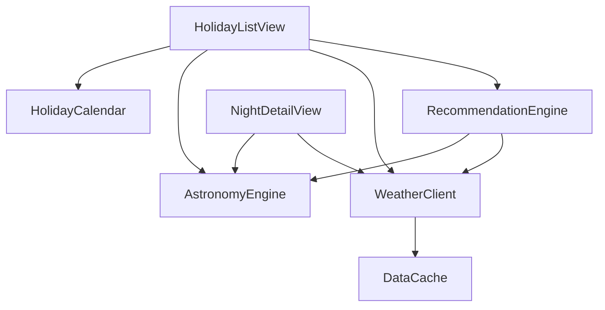

# Component Catalogue — 별 보기 좋은 날 추천 앱

> 코드로 작성할 논리 블록. 정적 클라이언트 앱(백엔드 없음). 날씨 API·천문 라이브러리·정적 호스팅은 외부 의존. 근거: requirements.md, stories.md, team-practices.md.

## Part A — 컴포넌트 카탈로그 (machine-readable)

```yaml
components:
  - name: AstronomyEngine
    summary: 날짜와 좌표로 달 위상·조도, 박명 시각, 월출·월몰을 계산
    behaviour: >
      주어진 날짜(KST)와 전국 대표 좌표로 달 조도(0~100%), 시민·항해·천문 박명 시각,
      완전한 밤 구간(저녁 천문박명 종료~새벽 천문박명 시작), 월출·월몰 시각을 결정론적으로 계산한다.
      월출 또는 월몰이 그날 밤에 없으면 "없음"으로 표기한다. 외부 천문 계산 라이브러리를 사용한다.
    responsibilities:
      - 달 조도 계산
      - 박명 구간 및 완전한 밤 계산
      - 월출·월몰 계산
    depends_on: []
    dependents:
      - component: RecommendationEngine
        interaction: 추천 판정에 쓸 달 조도 제공
      - component: HolidayListView
        interaction: 카드 요약용 달 위상·조도
      - component: NightDetailView
        interaction: 상세 그래프용 달 밝기·박명·월출몰
    external_dependencies:
      - name: 오픈소스 천문 계산 라이브러리
        kind: other
        purpose: 달·박명·월출몰 천문 계산
    entities:
      - name: AstronomyResult
        identifier: dateKstId
        attributes: [dateKstId, moonIlluminationPct, civilTwilight, nauticalTwilight, astronomicalTwilight, fullDarkStart, fullDarkEnd, moonrise, moonset]

  - name: WeatherClient
    summary: 무료 날씨 API에서 구름량(운량) 예보를 가져오는 어댑터
    behaviour: >
      예보 지평 안의 날짜에 대해 외부 무료 날씨 API로 시간별 구름량(%)을 가져온다.
      예보가 없는 먼 날짜는 "예보 없음"으로 반환한다. 호출 실패 시 "실패"를 반환해 호출부가 부분 상태를 표시하게 한다.
      키가 필요 없는 공개 API를 우선 사용하고 비밀값을 클라이언트에 두지 않는다.
    responsibilities:
      - 구름량 예보 조회
      - 예보 지평 유무 판별
      - 실패/없음 구분 반환
    depends_on:
      - component: DataCache
        interaction: 조회 결과를 짧게 캐시
        style: sync
    dependents:
      - component: RecommendationEngine
        interaction: 추천 판정에 쓸 구름량 제공
      - component: HolidayListView
        interaction: 카드 요약용 구름 상태
      - component: NightDetailView
        interaction: 상세 그래프용 구름량 곡선
    external_dependencies:
      - name: 무료 날씨 API(Open-Meteo류)
        kind: third-party-api
        purpose: 구름량(운량) 예보
    entities:
      - name: CloudForecast
        identifier: dateKstId
        attributes: [dateKstId, hourlyCloudPct, status]

  - name: HolidayCalendar
    summary: 앞으로 3개월 이상의 주말과 한국 공휴일 연휴를 산출
    behaviour: >
      현재 시점부터 3개월 이상 앞의 주말과 한국 공휴일 연휴를 날짜순으로 만든다.
      공휴일 연휴가 없으면 주말만이라도 포함한다. "그날 밤"은 KST 기준 저녁~다음날 새벽으로 묶는다.
    responsibilities:
      - 주말·공휴일 연휴 날짜 산출
      - KST 기준 밤 범위 결정
    depends_on: []
    dependents:
      - component: HolidayListView
        interaction: 카드 목록의 날짜 집합 제공
    external_dependencies:
      - name: 한국 공휴일 데이터/규칙
        kind: other
        purpose: 공휴일 연휴 판별
    entities:
      - name: CalendarDate
        identifier: dateKstId
        attributes: [dateKstId, label, isHoliday, isWeekend]

  - name: RecommendationEngine
    summary: 달 조도와 구름량으로 "관측 좋은 날" 추천 여부를 판정
    behaviour: >
      달 조도 <= 20%를 "어두운 밤"으로, 구름량 <= 30%를 "구름 적음"으로 본다(잠정 임계값, 설계에서 조정 가능).
      구름 예보가 있는 날은 달 어두움 AND 구름 적음일 때 추천, 구름이 많으면 추천 제외.
      구름 예보가 없는 먼 날은 달 조도만으로 판정한다.
    responsibilities:
      - 추천 여부 판정
      - 추천 임계값 규칙 보유
    depends_on:
      - component: AstronomyEngine
        interaction: 달 조도 입력
        style: sync
      - component: WeatherClient
        interaction: 구름량 입력(있으면)
        style: sync
    dependents:
      - component: HolidayListView
        interaction: 카드별 추천 여부
    external_dependencies: []
    entities: []

  - name: DataCache
    summary: 가져온 날씨 예보 결과를 짧게 캐시해 무료 한도를 보호
    behaviour: >
      WeatherClient가 가져온 날씨 예보 결과를 짧은 TTL로 캐시해 과도한 재호출을 막는다.
      온라인 전제이며 오프라인 전용 저장은 하지 않는다. (천문 계산은 결정론적·로컬이라 캐시 대상이 아니다.)
    responsibilities:
      - 단기 캐시 보관·만료
    depends_on: []
    dependents:
      - component: WeatherClient
        interaction: 조회 결과 캐시 저장·조회
    external_dependencies: []
    entities: []

  - name: HolidayListView
    summary: 메인 화면 — 연휴·주말 카드 목록과 추천 강조
    behaviour: >
      HolidayCalendar의 날짜마다 카드를 만들어 날짜/연휴명, 달 아이콘+조도, (예보 있는 날) 구름 요약을 표시하고,
      RecommendationEngine이 추천으로 판정한 카드는 노란 테두리+별 아이콘+"추천" 라벨로 강조한다(색 비의존).
      로딩/빈/부분/에러 상태를 구분한다. 카드 탭 시 상세로 이동.
    responsibilities:
      - 카드 목록 렌더링
      - 추천 강조 표시
      - 목록 상태 처리
    depends_on:
      - component: HolidayCalendar
        interaction: 날짜 집합
        style: sync
      - component: AstronomyEngine
        interaction: 카드 요약용 달 조도
        style: sync
      - component: WeatherClient
        interaction: 카드 요약용 구름 상태
        style: sync
      - component: RecommendationEngine
        interaction: 추천 여부
        style: sync
    dependents: []
    external_dependencies: []
    entities: []

  - name: NightDetailView
    summary: 상세 화면 — 선택한 밤의 이중축 그래프와 요약
    behaviour: >
      선택한 밤에 대해 x=시간, 좌y=달 밝기(실선), 우y=구름량(점선)의 이중축 그래프와 박명 음영,
      완전한 밤 구간·월출·월몰 숫자 요약, 범례를 표시한다. 먼 날은 구름 곡선 없이 안내,
      날씨 호출 실패는 "불러오기 실패"로 구분, 천문 계산 실패는 에러+재시도. 추천 배지는 표시하지 않는다.
    responsibilities:
      - 이중축 그래프 렌더링
      - 핵심 숫자 요약·범례
      - 상세 상태 처리
    depends_on:
      - component: AstronomyEngine
        interaction: 달 밝기·박명·월출몰
        style: sync
      - component: WeatherClient
        interaction: 구름량 곡선(있으면)
        style: sync
    dependents: []
    external_dependencies: []
    entities: []
```

## Part B — 사람이 읽는 뷰

### Component Diagram



<!-- Text fallback: HolidayListView는 HolidayCalendar·AstronomyEngine·WeatherClient·RecommendationEngine을 호출한다. NightDetailView는 AstronomyEngine·WeatherClient를 호출한다. RecommendationEngine은 AstronomyEngine·WeatherClient를 호출한다. WeatherClient는 DataCache를 사용한다. 순환 없음(비순환). -->

### Component Summary

| Component | Purpose | Depends On | Dependents | Entities Owned |
|-----------|---------|------------|------------|----------------|
| AstronomyEngine | 달·박명·월출몰 계산 | — | RecommendationEngine, HolidayListView, NightDetailView | AstronomyResult |
| WeatherClient | 구름량 예보 어댑터 | DataCache | RecommendationEngine, HolidayListView, NightDetailView | CloudForecast |
| HolidayCalendar | 주말·공휴일 연휴 산출 | — | HolidayListView | CalendarDate |
| RecommendationEngine | 추천 판정 | AstronomyEngine, WeatherClient | HolidayListView | — |
| DataCache | 단기 캐시 | — | WeatherClient | — |
| HolidayListView | 메인 카드 목록 | HolidayCalendar, AstronomyEngine, WeatherClient, RecommendationEngine | — | — |
| NightDetailView | 상세 그래프 | AstronomyEngine, WeatherClient | — | — |

### Entity Ownership

| Entity | Owning Component | Identifier | Attributes | References |
|--------|------------------|------------|------------|------------|
| AstronomyResult | AstronomyEngine | dateKstId | dateKstId, moonIlluminationPct, 박명 3종, fullDarkStart/End, moonrise, moonset | — |
| CloudForecast | WeatherClient | dateKstId | dateKstId, hourlyCloudPct, status | — |
| CalendarDate | HolidayCalendar | dateKstId | dateKstId, label, isHoliday, isWeekend | — |

(엔티티는 공통 식별자 `dateKstId`(KST 날짜 키)로 느슨히 연관되며, 상세 타입·제약은 Functional Design에서 정의한다.)

### External Dependencies

| Component | Dependency | Kind | Purpose |
|-----------|-----------|------|---------|
| AstronomyEngine | 오픈소스 천문 계산 라이브러리 | other | 달·박명·월출몰 계산 |
| WeatherClient | 무료 날씨 API(Open-Meteo류) | third-party-api | 구름량 예보 |
| HolidayCalendar | 한국 공휴일 데이터/규칙 | other | 공휴일 연휴 판별 |

### Rationale

| Component | 왜 별도 블록인가 |
|-----------|------------------|
| AstronomyEngine | 결정론적 계산, 외부 라이브러리 경계, 변경률 낮음 |
| WeatherClient | 외부 API 어댑터(포트) — API 교체·실패 처리를 격리 |
| HolidayCalendar | 날짜/공휴일 규칙이라는 독립 관심사 |
| RecommendationEngine | 추천 임계값·규칙이 자주 바뀔 수 있어 계산과 분리(Q1=A) |
| DataCache | 캐시 정책을 한 곳에 모아 무료 한도 보호 |
| HolidayListView / NightDetailView | 화면도 작성할 코드 블록이며 데이터/계산과 분리(Q2=A), 서로 다른 변경률 |

**Alternatives Rejected**: 추천 판정을 AstronomyEngine에 합치는 안(Q1-B)은 임계값 변경이 계산 블록을 건드리게 해 반려. 화면을 컴포넌트로 다루지 않는 안(Q2-B)은 의존 흐름이 불명확해져 반려.

## Assumptions & Open Questions

- 전국 대표 좌표의 구체 위치, 천문 라이브러리·날씨 API 선정은 이후 단계에서 확정. [assumption]
