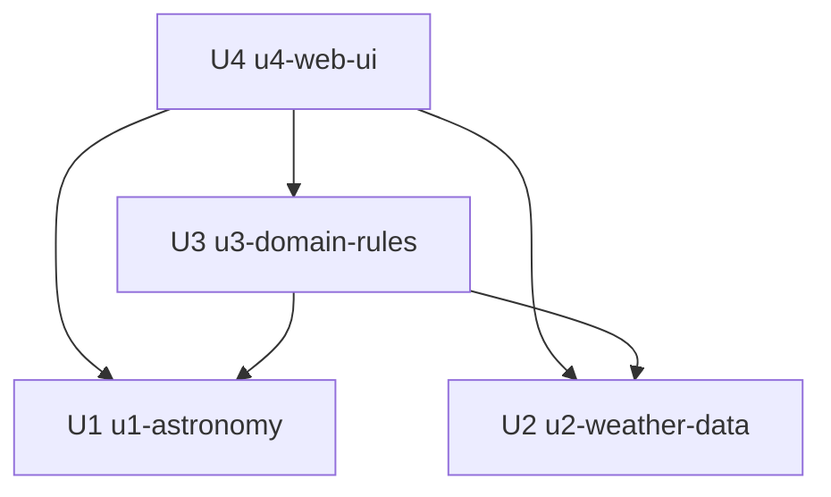

# Unit Dependency DAG — 별 보기 좋은 날 추천 앱

> 근거: unit-of-work.md, domain-design/components.md(컴포넌트 의존), units-generation-questions.md(Q4=A).
> 이 문서는 단위 간 의존 위상(topology)만 기술한다. 빌드 순서·우선순위는 Delivery Planning이 이 DAG를 입력으로 결정한다.

## 의존 관계 (방향: "A는 B에 의존")

- U3(u3-domain-rules)는 U1(u1-astronomy)과 U2(u2-weather-data)에 의존한다 — 추천 판정에 달 조도(U1)와 구름량(U2)이 필요하기 때문.
- U4(u4-web-ui)는 U1, U2, U3 모두에 의존한다 — 화면이 천문 계산·날씨 데이터·달력/추천 결과를 모두 호출하기 때문.
- U1과 U2는 다른 단위에 의존하지 않는다(독립, `depends_on: []`).

순환 없음(비순환, DAG).

## 의존 그래프



<!-- Text fallback: U4(web-ui)는 U1(astronomy)·U2(weather-data)·U3(domain-rules)에 의존한다. U3(domain-rules)은 U1·U2에 의존한다. U1·U2는 의존 없음. 순환 없음. -->

## 통합 지점 (Q4=A: 브라우저 내 동기 모듈 호출)

| From | To | 방식 | 주고받는 것 |
|------|----|------|-------------|
| U3 | U1 | sync (함수 호출) | 날짜·좌표 → AstronomyResult(달 조도 등) |
| U3 | U2 | sync (함수 호출) | 날짜 → CloudForecast(구름량, 없음/실패 상태 포함) |
| U4 | U1 | sync (함수 호출) | 카드/상세용 달 밝기·박명·월출몰 |
| U4 | U2 | sync (함수 호출) | 카드/상세용 구름량(있으면) |
| U4 | U3 | sync (함수 호출) | 날짜 집합(달력) + 카드별 추천 여부 |
| U2 | (외부) 무료 날씨 API | third-party-api | 시간별 구름량 예보 조회 |
| U1 | (외부) 천문 계산 라이브러리 | library | 달·박명·월출몰 계산 |

단위 간에는 네트워크 경계가 없다(단일 정적 번들). 외부 경계는 U2의 날씨 API와 U1의 천문 라이브러리 두 곳뿐.

## 병렬 개발 기회

- **U1과 U2는 서로 의존하지 않는다** — 독립적으로 병렬 개발 가능.
- U3은 U1·U2의 인터페이스(입력/출력 모양)만 합의되면 그에 맞춰 병렬 착수 가능.
- U4는 U1·U2·U3의 호출 인터페이스가 정해지면 병렬 착수 가능.
- 여러 유효한 위상 정렬이 존재한다(예: U1·U2 → U3 → U4, 또는 U2·U1 → U3 → U4). 어떤 경로로 실제 착수할지는 Delivery Planning의 경제적 결정이다.

## 워킹 스켈레톤 참고

워킹 스켈레톤 적용 여부는 활성 스코프(feature) 기본값에 맡겨져 있다(team-practices: 하드 on/off 아님). 적용될 경우, 가장 얇은 엔드투엔드 슬라이스는 "U1의 달 조도 계산 → U3의 단순 추천 판정 → U4 메인 목록에 한 날짜 카드 표시"로, DAG 상 U1을 먼저 충분히 실현해야 성립한다. 최종 통합 데모·검증은 Delivery Planning이 확정한다.

## 머신 판독 엣지 블록

```yaml
units:
  - name: u1-astronomy
    kind: library
    depends_on: []
  - name: u2-weather-data
    kind: library
    depends_on: []
  - name: u3-domain-rules
    kind: library
    depends_on: [u1-astronomy, u2-weather-data]
  - name: u4-web-ui
    kind: ui
    depends_on: [u1-astronomy, u2-weather-data, u3-domain-rules]
```

## Assumptions & Open Questions

None.
